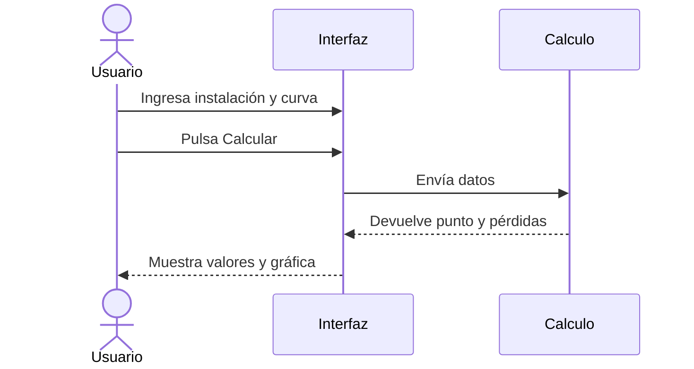

# PumpCalc: contexto, modelo numérico e implementación inicial

## 1. Contexto del proyecto

PumpCalc es un proyecto del curso de **Métodos Numéricos** que estima el comportamiento de una bomba de agua conectada a una instalación sencilla. Su propósito es responder una pregunta práctica: **¿qué caudal entregará una bomba después de conectarla a una tubería real, y alcanza ese caudal para el uso previsto?** La ficha del fabricante describe la altura que la bomba puede proporcionar a distintos caudales, mientras que la instalación exige una altura que aumenta con el caudal por el desnivel y las pérdidas hidráulicas. El valor que satisface ambas condiciones es el *punto de operación*. Conocerlo permite comparar una configuración propuesta con la necesidad de agua del usuario antes de comprar o montar sus componentes.

La propuesta general se planteó como aplicación web. Esta primera entrega es una **aplicación de escritorio en Python** para concentrar el trabajo en el modelo matemático y el método numérico. Analiza agua, una bomba, una línea principal de tubería de diámetro constante y flujo estacionario. Los datos de la curva de la bomba se introducen manualmente. Cada cálculo corresponde a una configuración; para estudiar otra, se modifican las entradas y se vuelve a calcular.

### Stakeholders

| Interesado | Relación con PumpCalc |
| --- | --- |
| Estudiante desarrollador | Construye y explica el modelo, implementa la bisección y verifica sus resultados. |
| Docente del curso | Evalúa la formulación del problema, el uso del método numérico y la correspondencia entre teoría y código. |
| Instalador o vendedor de bombas | Podría usar la estimación para conversar sobre una bomba y una instalación propuestas. |
| Propietario o responsable de la instalación | Quiere saber si el caudal previsto se aproxima a su necesidad antes de comprar o montar el equipo. |

### Situación problema: un caso concreto

Supóngase que se quiere bombear agua por **40 m de tubería PVC** de **32 mm de diámetro interior**, con **12 m de desnivel**, dos codos de 90°, una válvula de compuerta abierta y una válvula de retención. La ficha de la bomba aporta los pares caudal–altura `(0, 38)`, `(2, 35)`, `(4, 29)`, `(6, 19)` y `(8, 5)`, en m³/h y m, respectivamente. Leer el último par como una promesa de **8 m³/h en esta instalación** sería un error: a ese caudal, la instalación requeriría aproximadamente **23,02 m**, y la bomba solo entregaría **5 m** según los datos introducidos.

Con estos datos, PumpCalc estima un punto de operación de **6,064 m³/h** y **18,55 m**. La altura requerida se descompone en **12 m de desnivel**, **5,56 m de pérdida en la tubería** y **0,99 m de pérdida en accesorios**. La velocidad estimada es **2,09 m/s**. El resultado es una estimación basada en la curva y en coeficientes hidráulicos aproximados, no una medición de la instalación ya construida.

### ¿Qué hace el usuario con el resultado?

El caudal calculado se compara con una **necesidad definida para el proyecto**, por ejemplo el caudal mínimo para llenar un tanque en cierto tiempo o alimentar un pequeño riego. Supóngase que en este caso se necesitan **al menos 6,5 m³/h**. La configuración con tubería de 32 mm entrega aproximadamente **6,064 m³/h**: el usuario ve que **no alcanza la meta** y evita asumir que los 8 m³/h del último punto de la ficha estarán disponibles una vez instalada la bomba.

Con la misma bomba y los demás datos iguales, el usuario puede probar una tubería de **40 mm de diámetro interior**. PumpCalc estima entonces **6,616 m³/h**, que sí supera la meta propuesta. La pérdida en la tubería baja de **5,56 m a 2,20 m**. Esos resultados permiten plantear una decisión concreta: evaluar si cambiar el diámetro es viable y cuánto cuesta; si no lo es, probar la curva de otra bomba o revisar el trazado de la instalación. Si la necesidad fuera inferior a 6,064 m³/h, la primera configuración podría bastar sin hacer ese cambio.

El beneficio del software es que **reúne en un mismo cálculo la curva real de la bomba, el desnivel, la tubería y los accesorios**, y muestra el caudal que resulta de su interacción. También separa las pérdidas para explicar *por qué* cambia el resultado al modificar una entrada. Así sirve como apoyo para descartar configuraciones insuficientes y comparar alternativas antes de gastar en equipos o montaje. PumpCalc **no decide automáticamente cuál opción comprar**: esta versión no recibe un caudal objetivo ni calcula costos. El usuario aporta su meta y contrasta el resultado con presupuesto, disponibilidad y condiciones reales de instalación.

## 2. Modelo matemático y método numérico

La variable que se busca es el **caudal de operación $Q$**. La bomba proporciona una altura $H_b(Q)$ que, en los puntos ingresados, proviene de su ficha técnica. Entre dos puntos consecutivos $(Q_i,H_i)$ y $(Q_{i+1},H_{i+1})$, el programa usa interpolación lineal:

$$
H_b(Q)=H_i+\frac{H_{i+1}-H_i}{Q_{i+1}-Q_i}(Q-Q_i).
$$

La altura que necesita la instalación se calcula como la suma del desnivel y las pérdidas:

$$
H_s(Q)=\Delta z+h_f(Q)+h_a(Q).
$$

Para la pérdida por fricción de la tubería se emplea la expresión empírica de **Hazen–Williams**, apropiada para una primera estimación con agua:

$$
h_f=\frac{10,67\,L\,q^{1,852}}{C^{1,852}D^{4,871}},
$$

donde $L$ es la longitud en metros, $D$ el diámetro interior en metros, $q$ el caudal en m³/s y $C$ el coeficiente del material. La interfaz recibe $Q$ en m³/h y $D$ en mm; el código convierte esos valores antes de aplicar la fórmula. Los coeficientes iniciales son $C=150$ para PVC, $C=120$ para acero y $C=100$ para hierro fundido.

Para los accesorios, primero se obtiene el área $A=\pi D^2/4$ y la velocidad $v=q/A$. Después se calcula:

$$
h_a=\left(\sum K\right)\frac{v^2}{2g}, \qquad g=9,81\ \text{m/s}^2.
$$

Cada cantidad de accesorios multiplica su coeficiente: codo de 90° $K=0,9$, válvula de compuerta abierta $K=0,15$ y válvula de retención $K=2,5$. En el ejemplo, $\sum K=2(0,9)+0,15+2,5=4,45$.

El **método numérico principal es la bisección**, aplicada a la función

$$
F(Q)=H_b(Q)-H_s(Q).
$$

Se busca una raíz $F(Q)=0$: en ese caudal, la altura que entrega la bomba coincide con la que exige la instalación. El programa revisa cada tramo de la curva ingresada hasta encontrar dos extremos donde $F$ cambia de signo. En el ejemplo, a **6 m³/h** se obtiene $F\approx 19-18,42=+0,58$ m; a **8 m³/h**, $F\approx 5-23,02=-18,02$ m. Por ello, el cruce está dentro de ese tramo. Bisección evalúa repetidamente el punto medio y conserva la mitad que contiene el cambio de signo, hasta aproximar el caudal de operación.

Este método se eligió porque el intervalo de búsqueda queda respaldado por los puntos de la ficha y el procedimiento es fácil de seguir: **evaluar, partir el intervalo y conservar la mitad pertinente**. No necesita derivadas ni una ecuación explícita para despejar $Q$. Si no existe un cruce dentro de los caudales suministrados, el programa lo informa; no prolonga la curva de la bomba fuera de esos datos.

## 3. Relación entre matemáticas y código

El archivo [`pumpcalc/hydraulics.py`](pumpcalc/hydraulics.py) reúne el cálculo numérico en Python puro, sin importaciones. La función `altura_instalacion()` convierte unidades, calcula $A$, $v$, $h_f$, $h_a$ y $H_s$, y devuelve esas magnitudes para que el resultado pueda explicarse. La función `altura_bomba()` aplica la interpolación lineal entre dos puntos consecutivos. Finalmente, `punto_operacion()` recorre los tramos de la curva, forma la diferencia $F(Q)$, ejecuta la bisección en el tramo con cruce y devuelve el caudal junto con las alturas y pérdidas calculadas.

El valor `None` devuelto por `punto_operacion()` significa que no se encontró una raíz en el intervalo proporcionado. Así, la interfaz puede mostrar ese resultado sin inventar un caudal fuera de la curva. El módulo de cálculo no depende de CustomTkinter: las ecuaciones y la búsqueda del punto de operación pueden leerse y probarse por separado de la ventana.

## 4. Implementación de la primera versión

[`main.py`](main.py) inicia la aplicación. [`pumpcalc/app.py`](pumpcalc/app.py) construye una única ventana con barra lateral y tres paneles: **Instalación**, **Curva de bomba** y **Resultados**. Al pulsar *Calcular*, la interfaz lee los campos, obtiene el coeficiente del material y la suma de los $K$, y llama a `punto_operacion()`. La gráfica se dibuja con `tkinter.Canvas`: une los puntos de la bomba, evalúa la curva de la instalación y marca su cruce. El último resultado se conserva en pantalla al hacer un cálculo nuevo para facilitar una comparación inmediata.

El proyecto usa un entorno virtual local `.venv` con **CustomTkinter** como dependencia de interfaz. Las funciones numéricas no requieren bibliotecas externas. No hay base de datos, cuentas de usuario ni almacenamiento de proyectos en esta entrega.

## 5. Requerimientos principales

| Tipo | Requerimiento |
| --- | --- |
| Funcional | Ingresar longitud, diámetro interior, material, desnivel y cantidades de los accesorios contemplados. |
| Funcional | Ingresar al menos dos pares caudal–altura de la curva de una bomba, ordenados por caudal. |
| Funcional | Calcular el punto de operación dentro de la curva ingresada y mostrar caudal, altura, velocidad y pérdidas. |
| Funcional | Mostrar en una gráfica las curvas de bomba e instalación y permitir recalcular después de cambiar los datos. |
| No funcional | Mantener el método numérico en un módulo Python independiente de la interfaz y sin importaciones. |
| No funcional | Ejecutarse desde el entorno virtual del proyecto en una sola ventana de escritorio. |

El alcance excluye redes ramificadas, varias bombas, diámetros variables en un mismo cálculo, control automático y fenómenos transitorios. Estas limitaciones mantienen el problema lo bastante acotado para estudiar con claridad la formulación de $F(Q)$ y la aplicación de la bisección.
